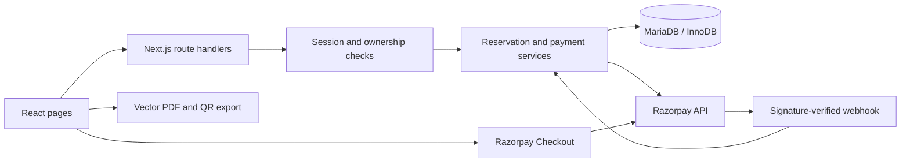

# FirstFly Airlines

A full-stack airline booking project built with **Next.js, React and MariaDB**, focused on transactional seat reservations, authenticated booking workflows and server-verified Razorpay payments.

The application connects flight discovery, seat selection, checkout, booking history and downloadable QR booking confirmations. Its engineering focus is keeping seat, booking and payment state consistent under concurrent requests and retries.

## Key features

- Travel-date search with origin/destination filters, overnight arrival dates and paginated flight cards.
- Seat selection across Economy and Business cabins, refreshed availability and five-minute reservations.
- Registration, login and logout with database-backed sessions and owner-scoped booking access.
- Razorpay order creation, payment verification, webhook processing and reconciliation.
- Booking history, cancellation, PNR/name lookup and vector PDF confirmations with QR codes.
- Repeatable demo inventory, additive migrations and isolated database tests.

## Tech stack

| Layer | Technologies |
| --- | --- |
| Frontend | React 19, Next.js App Router, JavaScript, CSS Modules, Tailwind CSS 4 |
| Backend | Next.js route handlers, Node.js, shared authentication/reservation/payment services |
| Database | MariaDB, InnoDB transactions, parameterized SQL through mysql2; no ORM |
| Payments | Razorpay Node SDK and browser Checkout |
| Tools | bcryptjs, jsPDF, react-qr-code, qr.js, Node test runner, ESLint, Git |

## Architecture



Route handlers delegate to shared services in `lib/`. Browser checkout results require server verification before a booking is confirmed. Database transactions protect state changes; external payment calls run outside those transactions.

```text
app/          Pages, components and API routes
lib/          Authentication, reservations, payments and presentation helpers
migrations/   Numbered, additive SQL migrations
scripts/      Setup, seeding, auditing, reconciliation and benchmarks
tests/       Unit and isolated MariaDB integration tests
docs/        Design decisions, setup details and recorded verification
public/       Favicon and licensed PDF fonts
```

## Application workflows

| Workflow | Implementation |
| --- | --- |
| Flight search | Require a date in the UI; filter by origin, destination or both. Dated flights match the selected day; clock-only legacy schedules use that date for display. Cards calculate next-day arrivals and retain the date through pagination. |
| Seat reservation | Select a seat and cabin. The server validates the fare/class and creates an owner-bound reservation attempt with a five-minute lease. |
| Payment | Persist passenger details, create or resume a Razorpay order, then verify the signature and provider payment state on the server. Webhooks and reconciliation support recovery. |
| Confirmation and cancellation | Successful finalization records one passenger booking and permanently books the seat. Owner-authorized cancellation preserves the booking history and releases inventory transactionally. |
| PNR-based check-in | Look up the signed-in user's active booking using its six-digit PNR and full passenger name. This is a booking lookup, not operational airline check-in. |
| QR boarding-pass view and PDF | Load the booking from the authenticated account. Export a landscape vector PDF with embedded fonts and two QR codes containing booking identifiers; no screenshot-based PDF generation. |

## Reliability and engineering highlights

- **Transactional reservations:** row locks, conditional updates and rollback protect seat acquisition, finalization and cancellation. Expired locks cannot reopen booked seats.
- **Concurrency and idempotency:** unique attempt/payment constraints and a unique confirmed-seat constraint prevent duplicate finalization. Release requires the matching user, flight, seat and attempt.
- **Authentication and authorization:** bcrypt password hashes; random session tokens in HTTP-only, SameSite cookies; hashed tokens in MariaDB; seven-day expiry, logout revocation and basic shared login/register rate limits. Protected operations derive identity server-side.
- **Payment integrity:** server-derived fares, persisted orders, constant-time signature comparison plus SDK verification, and provider checks for payment/order IDs, amount, currency and captured status. Late or ambiguous payments enter review rather than reclaiming a seat.
- **Query design:** indexes support origin/destination searches and booking ownership lookups. Flight search returns 12 results per page with a 13-row lookahead. No percentage performance improvement is claimed.

Details: [seat consistency](docs/seat-reliability.md), [authentication](docs/authentication.md), [payments](docs/payment-workflow.md), [database performance](docs/database-performance.md).

## Verified metrics

Recorded local checks from **4 November 2026**, unless noted. These are development verification results, not production traffic metrics.

| Measure | Verified result |
| --- | --- |
| Clean demo seed | 120 flights; 10,800 seats; 90 seats per flight |
| Database schema | 11 tables; 6 numbered migrations |
| API surface | 17 method/path pairs; seat confirmation is a compatibility alias |
| Unit tests | 30 passed |
| MariaDB integration tests | 42 passed; payment provider mocked |
| Clean setup | Migrations and seed run twice; no duplicate reseeding |
| Concurrent reservation benchmark | 20 requests: 1 reservation, 19 conflicts, 0 unexpected errors; cleanup verified |
| Local benchmark duration | 171.57 ms request batch; 742.84 ms full run |
| Build and lint | Production build passed; lint: 0 errors, 3 existing image warnings |
| PDF verification, 3 November | Three sample variants; both QR codes decoded at 150/300 DPI; browser download verified with synthetic data |

The benchmark exercises real HTTP against shared handlers and an isolated MariaDB database, **not Next.js server throughput**. See [verification scope](docs/repository-cleanup.md) and [benchmark documentation](docs/concurrency-benchmark.md).

## API reference

All paths are relative to the application. Protected routes use the session cookie; webhook authentication uses the Razorpay signature.

| Method | Endpoint | Purpose |
| --- | --- | --- |
| POST | `/api/auth/register` | Register and create a session |
| POST | `/api/auth/login` | Authenticate and rotate the session |
| POST | `/api/auth/logout` | Revoke the session |
| GET | `/api/auth/me` | Return the authenticated user |
| GET | `/api/flights` | Search with `from`, `to`, `date`, `page`, or look up `id` |
| GET | `/api/status` | Read stored flight status using `flight` |
| GET | `/api/seats/get` | Read seat availability |
| POST | `/api/seats/lock` | Acquire an authenticated seat reservation |
| POST | `/api/seats/release` | Release the matching owned reservation |
| POST | `/api/seats/confirm` | Compatibility alias for booking finalization |
| POST | `/api/payment` | Prepare an attempt and create/resume its order |
| POST | `/api/payment/reconcile` | Recheck the owner's payment attempt |
| POST | `/api/payment/webhook` | Verify and process provider events |
| POST | `/api/book` | Verify payment and finalize the booking |
| POST | `/api/book/cancel` | Cancel the owner's booking |
| GET | `/api/bookings` | List the owner's booking history |
| GET | `/api/checkin` | Find an owned active booking by `pnr` and `name` |

## Database overview

| Table | Responsibility |
| --- | --- |
| `users` | Accounts and password hashes |
| `auth_sessions` | Hashed session tokens and expiry |
| `auth_rate_limits` | Shared authentication attempt counters |
| `flights` | Routes, stored schedules, base fares and status |
| `seats` | Per-flight inventory and reservation metadata |
| `reservation_attempts` | Owner/seat association, fare and passenger snapshot, order/payment references and lifecycle |
| `passengers` | Current booking records, PNRs and cancellation history |
| `bookings` | Legacy booking table retained for compatibility and conflict protection |
| `payment_records` | Provider payment evidence and resolution/review state |
| `payment_webhook_events` | Webhook deduplication and processing state |
| `demo_flights` | Seed ownership, stable keys and dated demo schedules |

The active booking workflow writes to `passengers`, not a second booking record in the legacy `bookings` table. Migrations preserve existing records; audits flag legacy conflicts for review.

## Screenshots

Screenshots to add using synthetic passenger data:

| View | Status |
| --- | --- |
| Flight results with a selected date | To add |
| Seat selection and cabin fares | To add |
| My Trips and booking status | To add |
| Online boarding-pass view and downloaded PDF | To add |

## Installation and local setup

Prerequisites: **Node.js 22+**, npm and MariaDB supporting `utf8mb4_uca1400_ai_ci`. Verification used Node.js 24.1.0 and MariaDB 12.2.2. Run commands from the repository directory containing `package.json` (`airline-system` in the local project workspace).

1. Clone or download this repository, then install the locked dependencies:

   ```sh
   npm ci
   ```

2. Copy the environment template:

   ```powershell
   Copy-Item .env.example .env.local
   ```

   On macOS/Linux, use `cp .env.example .env.local`.

3. Create a database through your MariaDB administration tool:

   ```sql
   CREATE DATABASE firstfly CHARACTER SET utf8mb4;
   ```

   Create/configure a database account, fill in `.env.local`, and grant that account the schema privileges needed for migrations. Local credentials are not supplied by the repository. Keep `.env.local` untracked.

4. Apply migrations, seed demo inventory and start the development server:

   ```sh
   npm run db:migrate
   npm run db:seed:demo
   npm run dev
   ```

   Open the local address printed by Next.js, register an account and select a travel date within the seeded range.

### Environment variables

Names match [`.env.example`](.env.example). Supply your own values; never commit credentials.

| Variable | Purpose |
| --- | --- |
| `DB_HOST` | MariaDB host |
| `DB_PORT` | MariaDB port |
| `DB_USER` | Database account |
| `DB_PASSWORD` | Database password |
| `DB_NAME` | Application database name |
| `RAZORPAY_KEY_ID` | Public Razorpay key ID for Checkout |
| `RAZORPAY_KEY_SECRET` | Matching server-only API secret |
| `RAZORPAY_WEBHOOK_SECRET` | Independent webhook secret, at least 16 characters |

Browsing and authentication work without payment keys. Checkout requires configured Razorpay credentials; missing configuration fails safely. For local demonstrations, use matching test-mode keys and automatic capture. Configure the signed webhook at `/api/payment/webhook` through a publicly reachable HTTPS host; see [payment setup](docs/payment-workflow.md).


### Migrations and demo seed

`npm run db:migrate` applies the six numbered SQL files in order. `npm run db:audit` performs a read-only consistency audit. Existing customer conflicts are not automatically repaired or deleted.

The seed creates 120 illustrative flights across 12 Indian cities and ten departure dates, starting seven days after the first run by default. Each flight has seats A1–F15: rows 1–3 Business, rows 4–15 Economy. An optional first-run start date can be supplied:

```sh
npm run db:seed:demo -- 2026-12-01
```

Choose an appropriate demonstration date. Reruns retain registered flights, dates and occupied seats; they do not create duplicate inventory or move an existing dataset forward. The seed creates no users, bookings or payments.

## Tests and local verification

| Command | Scope |
| --- | --- |
| `npm test` | Unit tests for validation, signatures, search and shared logic |
| `npm run test:integration` | Real MariaDB transaction/ownership/failure tests with mocked payments |
| `npm run test:setup` | Empty schema, migrations twice, seed twice and authentication/reservation checks |
| `npm run benchmark:seats` | 20 authenticated requests competing for one test seat; no payment calls |
| `npm run lint` | ESLint checks |
| `npm run build` | Production compilation and page generation |
| `npm start` | Serve the completed production build |
| `node scripts/verify-booking-pdf.mjs` | Generate three synthetic PDF samples |

Database tests and the benchmark require a **local** MariaDB host and privileges to create/drop their randomly named temporary databases; failure tests also require trigger privileges. Their cleanup targets only test data. The application database is not used as the integration-test database.

Build-time Google fonts require network access. Production session cookies are Secure; use HTTPS for production authentication and `npm run dev` for normal local HTTP testing. Optional PDF rendering checks are documented in [PDF export](docs/pdf-export.md).

Operator commands: `npm run payments:reviews` lists review cases; `npm run payments:reconcile` rechecks provider state and can finalize eligible bookings. Reconciliation is not a read-only command and has no built-in scheduler.

## Limitations and future improvements

- **Demo schedules:** airline names, routes and fares are illustrative, not airline affiliations or live schedules. Status telemetry, weather and map information are simulated; there is no live tracking feed.
- **Date-specific inventory:** seats belong to a flight record, not recurring daily departures. For legacy clock-only flights, the selected date affects card presentation but is not persisted as a separate booked departure. Dated demo flights are the clearer demonstration path; recurring-service inventory is future work.
- **Check-in and QR codes:** booking lookup does not record operational check-in. QR codes identify a booking and are not signed airline boarding credentials. Physical printing and broader non-Latin font coverage remain unverified.
- **Payments:** no live Razorpay charge or provider-delivered webhook was verified. Refund execution, chargebacks, late captures and ambiguous orders require operator review. A captured payment after lease expiry cannot take another reservation's seat.
- **Account and operations:** password reset, email verification, social login, MFA and an admin dashboard are not implemented. Deployment needs HTTPS, ingress abuse controls, monitoring, backups and retention policies.
- **Scale:** My Trips remains unpaginated; flight search uses OFFSET pagination. Larger-data profiling and automated reconciliation scheduling are future improvements.

Further design and verification records are available in [the project documentation](docs/).
